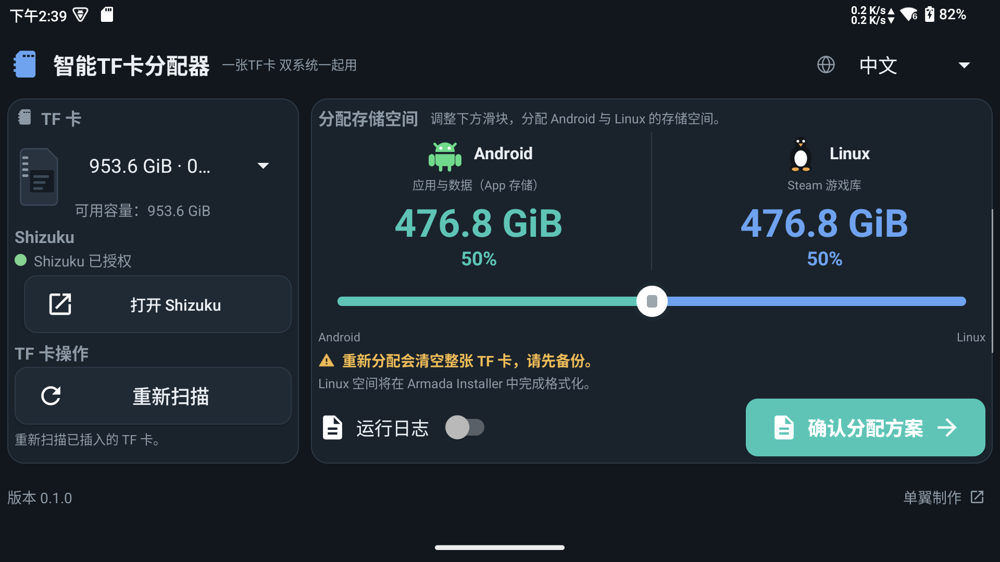

# Smart TF Card Allocator

English | [简体中文](README.zh-CN.md)

**One TF card. Both systems.**

Split a microSD card between Android app storage and a Linux game library with a single slider. Smart TF Card Allocator (智能TF卡分配器) is the Android companion to [Armada Installer](https://github.com/mydanyi/armada-installer) for handhelds running Android and ArmadaOS.

[Download APK](https://github.com/mydanyi/smart-tf-allocator/releases/latest) · [Armada Installer](https://github.com/mydanyi/armada-installer) · [Report an issue](https://github.com/mydanyi/smart-tf-allocator/issues)



> **Allocating space erases the entire selected TF card. Back up your files first.** This is a repartitioning tool; it cannot resize existing partitions without erasing them.

## Features

- Choose how much space goes to Android and Linux, with a live capacity estimate. The middle of the slider (an Android share of 10%–90%) creates a mixed card; either end gives the whole card to a single system.
- Set up Android adopted storage for supported apps and their data, including a card that is entirely Android storage.
- Prepare a companion partition that Armada Installer can recognize and format as a Linux game library, or hand the whole card to Linux.
- Use Shizuku on an unrooted device, or start Shizuku with root on a rooted device.
- Work on non-root firmware that blocks reading the card's hardware CID: the app identifies the card by its volume instead, so no root or security setting is needed. A Linux share created this way needs Armada Installer 0.5.0 or later; cards with a readable CID keep the existing flow.
- Use the dark interface with touch or a controller, with a layout suited to landscape handheld screens.
- Switch between English and Simplified Chinese in the app.
- Turn runtime logs on or off and copy them when reporting a problem.

## Requirements

- Android 8.0 or later and a microSD card slot.
- Firmware that supports Android adoptable storage. Availability depends on the device firmware.
- [Shizuku](https://shizuku.rikka.app/) installed, running and authorized for this app.
- For the Linux side: ArmadaOS installed on internal storage and an [Armada Installer](https://github.com/mydanyi/armada-installer) version with **TF game library** support. An all-Linux card needs that version; if the firmware hides the card's hardware CID, the Linux share also needs Armada Installer 0.5.0 or later. An all-Android card needs no Linux step.

This app does not install ArmadaOS. For system images and device support, see the official [ArmadaOS project](https://github.com/armada-os/armada).

## How to use

1. Back up the TF card, then install the APK from [Releases](https://github.com/mydanyi/smart-tf-allocator/releases/latest).
2. Start Shizuku and authorize Smart TF Card Allocator. On Android 11 or later, wireless debugging lets you start Shizuku on the device without root. For other startup methods, follow the [official Shizuku guide](https://shizuku.rikka.app/guide/setup/) and the instructions shown by your installed version. After a reboot, start Shizuku again if needed.
3. Open the app, select the TF card and use **Rescan** if needed.
4. Move the slider to choose the split. The ends give the whole card to one system; the 10%–90% Android range shares the card. Capacities are approximate and allow for Android storage metadata.
5. Select **Confirm allocation plan**, check the selected card and sizes, then select **Erase & partition** to proceed.
6. Keep the card inserted and the app open until allocation finishes and, if you kept a Linux share, the Linux handoff write also finishes. If only the handoff write fails, use **Retry write**. An all-Android card finishes with no Linux step.
7. If you allocated Linux space, boot ArmadaOS from internal storage. In Armada Installer, choose **TF game library**, select the matching card and follow the prompts to format and mount its Linux partition and connect the game library.

| Component | Responsibility |
| --- | --- |
| Smart TF Card Allocator — Android | Allocate the card, initialize Android adopted storage and prepare the Linux handoff |
| Armada Installer — ArmadaOS | Recognize the companion partition, format it for Linux and mount it for the game library |

Only apps supported by Android and the device firmware can use adopted storage. The allocator does not move apps automatically. Android adopted storage is encrypted and tied to the device; it is not a portable shared drive. Once the Linux partition is formatted for Linux, Android may no longer be able to read it.

## Logs and troubleshooting

Enable **Logs** to view runtime events and use **Copy logs** to include them in an issue. Please include the device model, Android version, app version and the action that failed. Remove any personal information before sharing logs.

## Build from source

Use JDK 17 and Android SDK 35. Gradle and plugin versions are pinned in the project.

```sh
./gradlew :app:assembleDebug
```

The APK is written to `app/build/outputs/apk/debug/`. The application ID is `io.github.mydanyi.armadatf`.

## License and credits

Original project code is licensed under [GNU GPL v3.0 or later](LICENSE). Third-party components and artwork retain their own terms; see [Third-party notices](THIRD_PARTY_NOTICES.md).

The Android robot is reproduced or modified from work created and shared by Google and used according to terms described in the [Creative Commons 3.0 Attribution License](https://creativecommons.org/licenses/by/3.0/). Android is a trademark of Google LLC.

## Support and community

For app issues, use [Issues](https://github.com/mydanyi/smart-tf-allocator/issues). For Linux game-library setup, see [Armada Installer](https://github.com/mydanyi/armada-installer). For system images and device support, see [ArmadaOS](https://github.com/armada-os/armada).

- Made by [单翼](https://space.bilibili.com/258786)
- [Support development](https://afdian.com/a/meetmiku)
- QQ fan group: 487945399
- QQ community group 2: 477426414
